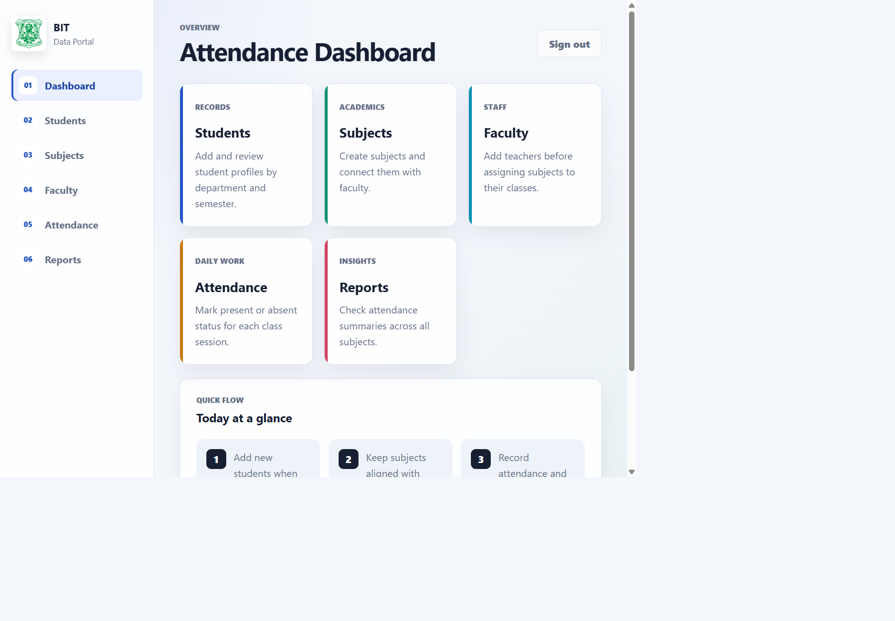
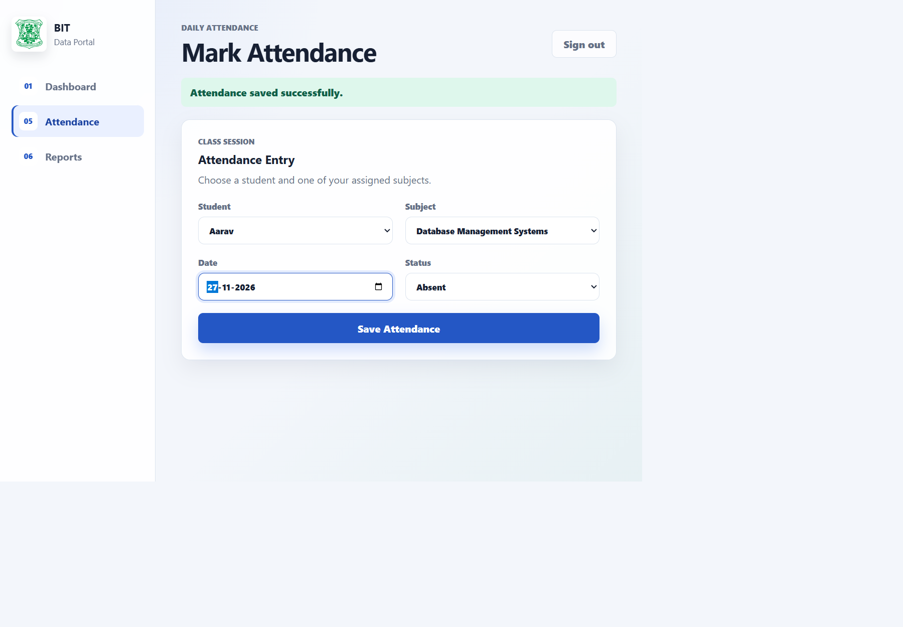
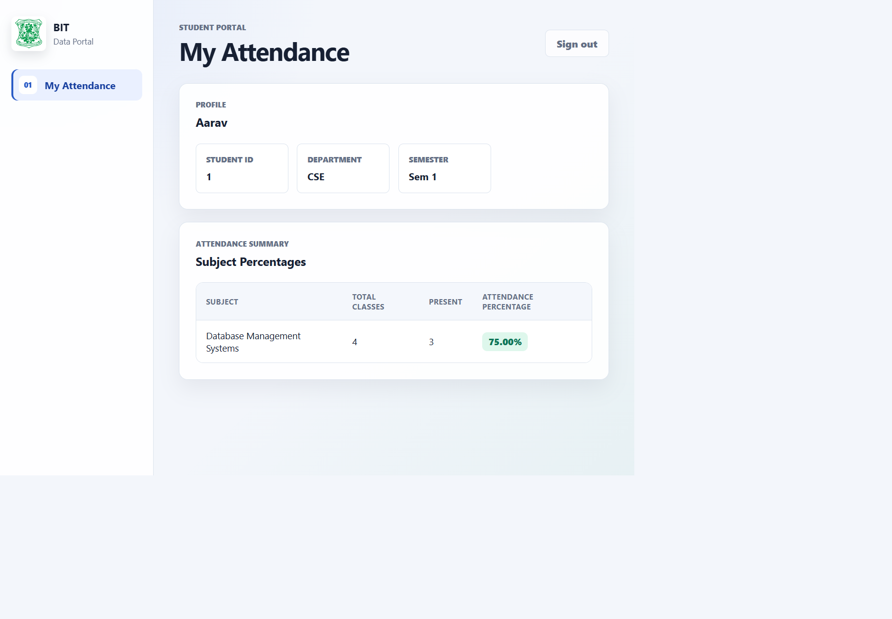

# BIT Student Attendance Management System

A local web app for recording class attendance and viewing attendance reports. It uses Flask with MySQL, Flask-MySQLdb, `python-dotenv`, and Werkzeug password hashing.

## Roles

- **Admin:** manage students, faculty accounts and records, subjects, attendance, and reports across the system.
- **Faculty:** mark attendance and view reports only for subjects assigned to their linked faculty record.
- **Student:** view their own attendance dashboard and percentage.

## Demo screenshots







## Local setup

Requirements: Python, a running MySQL server, and the MySQL command-line client (`mysql`). The app defaults to MySQL port `3307`; use the port configured for your server.

1. Create a virtual environment and install dependencies:

   ```powershell
   py -m venv .venv
   .\.venv\Scripts\Activate.ps1
   py -m pip install -r requirements.txt
   ```

2. Create `.env` from `.env.example` if needed, then set a random `FLASK_SECRET_KEY` and your MySQL host, port, username, and password. Choose a new disposable schema name and set the same name in `MYSQL_DB`. The commands below use `attendance_demo`; if that schema already exists, choose another unused name and replace `attendance_demo` below. Do not overwrite a database you want to keep.

   ```powershell
   if (!(Test-Path .env)) { Copy-Item .env.example .env }
   py -c "import secrets; print(secrets.token_urlsafe(48))"
   # Put the generated value in FLASK_SECRET_KEY in .env; edit the other MYSQL_* values there too.
   ```

3. Build and import the demo schema. `database.sql` starts with `DROP DATABASE IF EXISTS attendance_db` and recreates that database. Never import the file as-is when you need to preserve `attendance_db`. The command below rewrites the database name in a temporary copy so only the selected disposable schema is dropped/recreated. It first finds the MySQL client on `PATH` or in the standard Windows install folder:

   ```powershell
   $demoDb = 'attendance_demo'
   $mysqlExe = (Get-Command mysql.exe -ErrorAction SilentlyContinue).Source
   if (!$mysqlExe) {
       $mysqlExe = Get-ChildItem (Join-Path $env:ProgramFiles 'MySQL') -Filter mysql.exe -Recurse -ErrorAction SilentlyContinue |
           Select-Object -First 1 -ExpandProperty FullName
   }
   if (!$mysqlExe) { throw 'Install the MySQL command-line client or add mysql.exe to PATH.' }
   $demoSql = Join-Path $env:TEMP "$demoDb.sql"
   (Get-Content .\database.sql -Raw).Replace('attendance_db', $demoDb) |
       Set-Content -Path $demoSql -Encoding ascii
   Get-Content $demoSql -Raw |
       & $mysqlExe -h localhost -P 3307 -u your_mysql_user -p
   ```

   Replace the host, port, and username in the import command with the values from `.env`. MySQL prompts for the password. This creates the demo seed accounts, sample students, subjects, and attendance. The seed records are demo fixtures; do not use them as real student data. The SQL fixture contains fixed development-only staff login values, which are public if this file is published. Never reuse them for real accounts or a deployed service.

4. Run both migrations against the demo database. The first hashes existing admin/faculty passwords and gives students random initial passwords, writing them to a new CSV outside the project. The second adds the explicit faculty-login-to-faculty-record link used for subject scoping.

   ```powershell
   $studentCredentials = Join-Path $env:TEMP ("attendance_demo_student_credentials_{0}.csv" -f [guid]::NewGuid().ToString('N'))
   py migrate_passwords.py --student-credentials $studentCredentials
   py migrate_role_permissions.py --database $demoDb
   ```

   Keep the generated CSV private and delete it after securely delivering the initial student credentials. The migration refuses to overwrite an existing CSV or write one inside the project. For databases other than this seeded demo, link faculty logins to their intended faculty records before they sign in.

5. Start Flask and open <http://127.0.0.1:5000>:

   ```powershell
   py app.py
   ```

   Use the demo admin/faculty accounts seeded by `database.sql`; students sign in with their student ID and the initial password from the migration CSV. The Flask development server is for local use only. Change the seeded staff passwords before sharing a demo.

## Data safety

Use a fresh disposable database for this setup. The import step intentionally recreates the selected schema; check that `MYSQL_DB` in `.env` matches `$demoDb` before running either migration. `migrate_role_permissions.py` also requires its `--database` argument to match `MYSQL_DB`. The migrations connect only to that configured database. No command here imports or migrates `attendance_db` unless you explicitly choose that name, which you must not do when preserving it.
